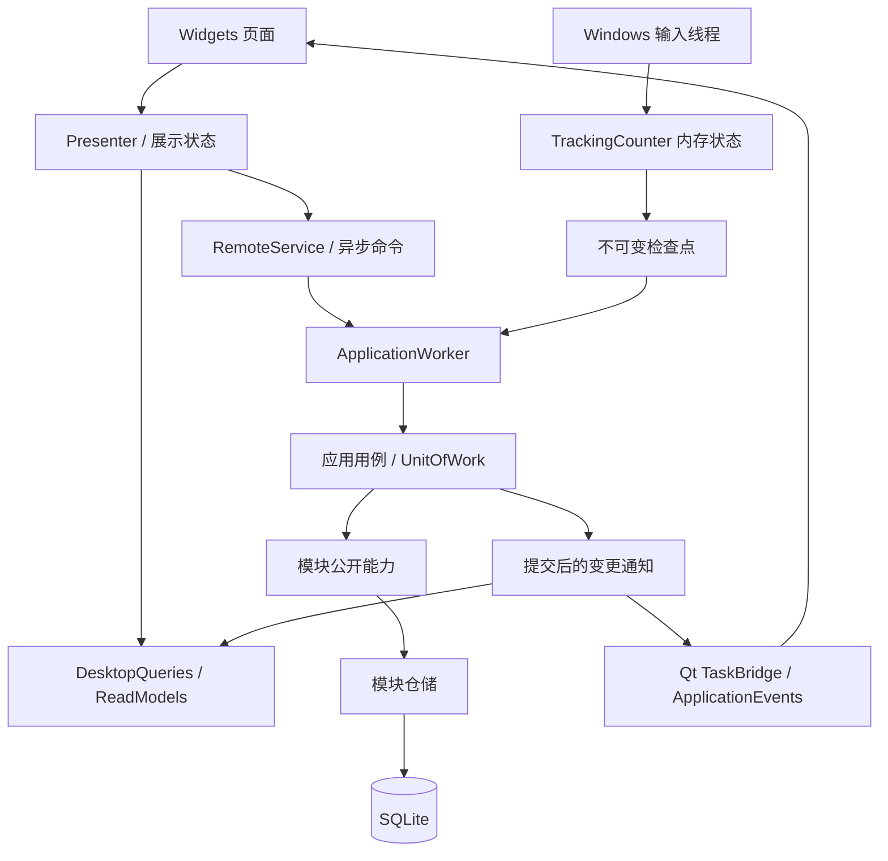

# Sariana 项目架构

Sariana 是 Windows 本机桌面应用，使用 Python、PySide6 Widgets、pyqtgraph 和 SQLite。当前采用模块化单体：一个进程、一个用户数据库、多个业务模块。没有 Redis、Web 后端、账户或云同步依赖。

## 启动和代码导航

先读 `main.py`，再读 `app/bootstrap/application.py` 和目标模块的 `api.py`。启动顺序为：单实例锁 → 应用工作线程创建数据库连接 → 迁移和恢复 → 装配模块服务 → 建立展示读模型 → 创建界面 → 启动输入钩子与定时保存。

| 位置 | 职责 | 修改时关注 |
| --- | --- | --- |
| `app/bootstrap/` | 装配、单一数据库工作线程、远程命令代理、展示读模型和功能入口 | 连接线程归属、启动失败、退出、异步命令 |
| `app/modules/*/api.py` | 对外服务、数据类型和能力契约 | 跨模块依赖、接口兼容 |
| `app/modules/*/repository.py` | 模块拥有的 SQLite SQL | 列归属、事务内写入 |
| `app/workflows/` | 跨模块用例、检查点、提交通知和导出 | 原子性、幂等、提交后的副作用 |
| `app/storage/` | 连接、版本迁移、工作单元、内部数据会话 | 旧库兼容、回滚、备份 |
| `app/integrations/ai/` | AI 协议、传输、请求结果和生成准入控制 | 配置快照、用量、超时、取消 |
| `app/integrations/companion_agent/` | 桌宠 LangGraph、模型适配、只读搜索工具 | 独立配置、流式正文过滤、取消与来源 |
| `app/integrations/updates/` | GitHub 版本查询、附件校验和安装进程交接 | HTTPS、取消、校验、退出授权 |
| `app/ui/` | Widgets、Presenter、Qt 异步桥接、主题和图表 | 输入法、保存状态、结果失效、布局 |
| `app/core/` | Windows 输入/TSF 适配、基础工具及旧入口 | 隐私、组字、不重复计数 |
| `config/` | 奖励配置、成就定义、内置词库 | 业务口径与资源路径 |
| `scripts/` | 隔离测试、预览、架构检查和构建 | 测试夹具与真实应用路径的差异 |

`app/services/`、`app/english/`、`app/companion/` 和部分 `app/core/` 文件仍保留旧导入的转发入口，供历史工具与测试使用。新业务代码从模块 `api.py` 接入。旧公共 `app/storage/repository.py` 已移除；`DataSession` 是工作流内部适配器，不应传进生产页面。

## 业务与数据归属

| 模块 | 自己负责的规则和数据 |
| --- | --- |
| tracking | 输入计数、统计快照、日切；`daily_stats` 的统计列、`minute_stats`、`lifetime` 的统计列 |
| practice | 普通范文、逐字评分、成绩和纪录、键盘侠；`challenge_history`、`ai_texts`、`keyboard_warrior_history` |
| english | 词库、拼写会话、单词对齐评分、复习和英语材料；`english_attempts`、`english_progress`、`english_sentences`、`english_review_schedule` |
| growth | 等级、经验、打卡、成就、库存、奖励上限和资格；`growth_daily`、`rewards`、`checkin_log`、`achievements`、经验相关列 |
| companion | 活动/情绪、互动、作品包、来信规则及 `companion_news_tasks`；作品目录 `companion/packs/` |
| profile | 昵称、签名、头像和配置保存；个人资料配置及头像文件 |
| reporting | 只读统计查询和有界查询缓存，不负责发奖或修改统计 |

物理表仍与旧版本兼容：tracking 不覆盖 `lifetime.total_exp` 或 `daily_stats.exp_gained`；growth 只更新经验列，不覆盖统计列。

`settings` 仍是共享键值表。`DataSession.set_settings()` 将经验结算、里程碑、加成和鼓励状态键路由到 growth 仓储，其余配置通过 profile 仓储保存。新的成长状态以 `growth_daily` 为主要持久化状态，旧经验设置键同时保留兼容。不要把出现在设置页的配置都变成一个万能业务服务。

## 调用与线程

- **Qt 主线程**管理窗口与控件。`TaskBridge` 将 Future 完成结果排队送回接收者的 Qt 线程；页面不得对未完成的 Future 调用 `result()` 等待。
- **ApplicationWorker**串行处理数据库命令。连接在该线程创建、使用和关闭，不能把连接转交给 UI 或网络线程，也不能通过关闭 SQLite 的线程检查掩盖违规访问。
- **输入线程**只更新带锁的内存计数器。上屏文本用于即时计数，不进入统计检查点或输入日志。
- **AI 网络线程**使用独立配置快照，不持有数据库连接，不修改 QWidget。
- 纯规则可以使用标准库 `urllib.parse` 解析 URL 文本；`urllib.request`、HTTP、socket 等传输依赖仍被架构检查拒绝，解析不等于访问来源。
- 启动时允许在创建窗口和输入钩子之前等待迁移与恢复完成。退出时等待已接收任务和最终检查点完成。

`bootstrap/read_models.py` 保存从数据库脱离的展示数据；设置有字典索引，时段数据在后台预聚合。界面读取这些模型，不执行 SQL。报表缓存按数据版本和筛选条件区分；热力图在数据变更时复用已有格子，主题、年份或布局变化才重建。

生产界面使用 `DesktopApplication` 和 `DesktopQueries`。部分历史测试/预览使用同步 `DataSession` 夹具；它们可以快速测试业务规则，但不能证明生产线程和异步行为正确。涉及异步时应同时运行 `test_desktop_architecture.py`。

## 事务、幂等和通知

`UnitOfWork.transaction()` 拥有提交；嵌套操作使用 savepoint。模块仓储不自行 `commit()`，也不使用隐式提交的连接上下文。`DataSession` 在模块方法外协调事务和变更主题。

需要共同成功的写入放在同一个用例中，例如：

- 补签：检查日期和资格 → 消费 1 张卡 → 写补签 → 发放经验/里程碑 → 提交。
- 完成训练：保存成绩和纪录 → growth 结算经验/日上限 → 登记操作结果 → 提交。
- 保存 AI 材料：校验内容 → 事务内重新检查资格 → 消费训练券 → 保存材料 → 登记操作结果 → 提交。

`operations` 以 `(kind, operation_id)` 唯一保存成功结果。重试沿用同一个 ID，重复提交返回原结果；不是每次重试都创建新 ID。打卡、成就等还使用自身日期/状态约束。周期统计用检查点版本去重，不为每个输入事件建立操作记录。

变更通知在最外层提交成功后发出，并合并为提交批次。应用装配层更新受影响读模型，再通知 UI。订阅者异常会记录日志，不撤销已提交写入。Toast、彩带、小伙伴反应不能在保存成功之前触发。

## 快照、恢复和日切

`TrackingSnapshot` 用于实时展示，包含应用日、版本、采集时间、计数、不可变分钟序列和终身统计。`Checkpoint` 包含待保存日期、脏分钟行和终身累计状态，两者都不保存被动输入正文。

1. 输入事件增加内存版本，并标记变化的日期和分钟。
2. 主窗口启动的保存定时器每 2 秒请求一次检查点；无变化不写库，已有保存任务未完成时不堆积新的同类任务。
3. `CheckpointWriter` 在同一事务中写统计、growth 经验结算/高水位和 `tracking_checkpoint` 元数据。
4. 提交成功才 `acknowledge()`；只清除该版本以前的脏标记，捕获之后的新输入保留待保存。
5. 失败保持脏状态供重试。提交成功但确认丢失时，持久化版本阻止再次写旧状态或重复发奖。
6. 启动恢复最后完整提交，接着同一分钟累计，不重复增加活跃分钟或已结算经验。

`AppCalendar` 按本机墙上时间和配置的日切小时计算应用日，默认凌晨 4 点；练习时长使用单调时钟。输入跨日时在同一把锁内转换日期，旧日待保存数据不会被清空。修改日切设置也走同一路径。分钟表保持近 30 天，每日清理一次。

2 秒是正常存储条件下的尝试保存间隔，不是磁盘故障或系统阻塞下的硬性恢复保证。UI 显示保存失败和最后成功保存时间。SQLite WAL 配合 `synchronous=FULL`；应用检查点不是 SQLite WAL checkpoint，也不是历史备份系统。

退出顺序是停止接收新命令 → 取消结果接收 → 停止 TSF/键盘输入线程 → 等待在途保存 → 捕获最终检查点 → 提交 → 关闭数据库线程。关窗驻留托盘继续统计。

## AI 请求生命周期

同一个 `AIService` 的配置快照共享 `GenerationGate`。普通范文、英语和混乱生成共用准入控制；连接测试使用独立测试路径。

- 开始前检查配置、等级和训练券；请求捕获配置和开发者临时权限，不随设置草稿变化。
- 网络请求不占数据库事务，结果通过 `AIResult` 携带正文、用量与错误。
- `GenerationLease` 只有在网络结束且结果处理结束后才释放。取消使结果失效，不能提前放行仍在运行的网络请求。
- 材料保存失败时保留结果和请求 ID，再次点击执行保存重试，不能重新调用模型。
- 离开页面后丢弃迟到结果，不保存、不扣券。已受理的保存事务按自己的提交结果完成。
- 满级免费生成、英语不额外发放练习经验、开发者权限不持久化等原有行为保留。

英语提示词与校验由 english 拥有；普通范文/混乱目前仍有 AIService 的兼容便利入口。新增生成业务应将提示词和业务校验放在对应模块，复用通用请求/传输与准入机制，避免继续扩大传输服务的业务职责。`last_usage` 仅保留兼容，UI 请求流程使用完整结果，不建立新的旁路可变状态。

## 迁移、扩展与验证

`storage/db.py` 使用 `PRAGMA user_version` 管理版本，当前为 3。旧库升级前用 SQLite Backup API 在同一数据目录的 `migration-backups/` 创建备份，再执行原子增量迁移；失败回滚并停止启动。未来变更新增迁移版本，不能只修改初始 `schema.sql`，因为已升级的数据库不会重新运行旧迁移。原数据目录和单实例锁名继续兼容 TypingTracker。

新增功能依次确认：数据/规则所属模块 → 扩展该模块公开 API → 用例与事务 → 仓储 → 启动注入/读模型 → Presenter → Widgets → 边界测试。新增跨模块能力由 workflows 编排，不直接导入另一模块的内部仓储。

验证入口：

- `scripts/check_architecture.py`：UI 不导入数据库、纯规则不依赖 Qt/网络/SQL、模块之间走 `api.py`。它检查明确列出的纯规则文件，不是完整的传递依赖分析；新增纯领域文件应加入检查集合。
- `scripts/test_architecture.py`：事务失败、幂等、日切、恢复、迁移、工作线程和缓存。
- `scripts/test_desktop_architecture.py`：真实工作线程与 Qt 的异步保存、准入、取消和错误反馈。
- 原有 `scripts/test_*.py` 与 `scripts/selftest.py`：产品回归。
- `.github/workflows/regression.yml`：Windows 回归；`.github/workflows/windows-release.yml`：冻结包、安装/升级验证与发布流程。

完整操作命令与 AI 任务模板见 [agent.md](agent.md)。

发布 0.9.5 起增加草稿发布路径：手动 Windows 工作流的 `publish_draft=true` 只在冻结包、安装/卸载和旧版本升级检查通过、四个附件上传后公开草稿。冻结包验证必需更新与复习模块；安装检查读取实际冻结包内更新代码验证注册表识别。匿名在线查询、下载和校验工具为 `scripts/verify_release_updates.py`，不启动安装器。

## 英语学习与间隔复习

拼写会话以纯状态机区分首次作答、纠正和轮末复测；`SpellingView` 是不可变展示状态。纠正输入不存成绩，首次错误不会被覆盖，每个需复测词只追加一次真实作答。准备的结果（含操作 ID 与应用日）在保存重试中保持不变；保存成功后 Presenter 才确认题目。UI 通过现有 profile 设置保存三档英语字号，使用 Widgets 与页面滚动保持可读性。

`english_review_schedule` 在迁移 2 新增，记录词库、单词、阶段、到期应用日和上次晋级日。记录作答与排期一起提交，重复 ID 不重排；排期纯规则接受应用日，不读取时钟。english 服务复用 tracking API 的 AppCalendar 和可注入时钟，展示查询从读模型计算今日到期，不在 UI 读取 SQL。版本 0 先执行原迁移 1 再执行迁移 2，版本 1 只执行增量迁移；迁移前使用原有 Backup API。

语句错误定位通过新增 `sentence_alignment` 与既有评分使用相同规范化和单词编辑距离；输入正文和对齐结果只用于当前界面，不进入学习记录。重练复用已保存材料，创建新的稳定作答 ID，不产生新的 AI 请求。

## GitHub 更新与退出

更新服务由 bootstrap 装配，独立网络线程检查版本与下载安装包，Qt TaskBridge 把状态回传 UI。自动检查每天最多一次；新版本通过应用通知提示，失败只更新设置状态。设置的「数据备份」分组包含更新入口，设置草稿开关仍在用户保存后生效。

安装前阻止在途学习保存，并对未完成学习要求明确放弃。停止采集后 `prepare_update_exit()` 在 ApplicationWorker 排空已受理命令并提交最终检查点；失败保持数据库线程、脏统计和重试能力，shell 恢复采集。成功才通过 `finish_update_exit()` 关闭数据库线程，授权本次隐藏安装辅助进程，释放单实例锁并退出。辅助进程等待主进程实际结束、验证授权标记和安装包后打开现有安装向导；关闭后的安装准备失败会安全退出并提示重新启动，不恢复已关闭工作线程。详细协议和人工验证范围见 [updates.md](updates.md)。

更新检查的传输层识别明确限流与普通拒绝访问，使用服务器恢复时间在当前服务实例中阻止重复 API 请求；不新增数据库状态、事务内网络或后台 UI 调用。手动最新版本网页入口独立于 API 查询，下载与安装授权、大小/SHA 校验和最终提交边界保持原有流程。行为及发布包范围见 [更新说明](updates.md)。

## 桌宠智能体

companion API 公开不可变配置、模型轮次、工具调用、运行限额、来源、进度与报告契约，默认角色/资料规则属于 companion 纯业务层；bootstrap 装配独立网络能力。LangGraph 在后台执行有界 `model → tools → model` 条件循环，模型可改写关键词、选择来源和补搜。MCP 工具层使用进程内 JSON-RPC 初始化/发现/调用子集，白名单只有公开搜索和已搜索来源的正文读取，错误作为观察反馈；未接入外部 MCP 服务器。次数、上下文、合作式截止时间与取消由运行层执行，不持有数据库、访问 QWidget 或开放文件/系统工具。桌宠 Presenter 通过 TaskBridge 和排队信号处理展示，使用请求 ID 丢弃取消后的进度与迟到结果；取消仍持有准入直到网络实际结束。源码对照见 [Pi 导读](pi-agent-study.md)。

智能体卡片与输入共用 `agent_visuals.py` 的纸张和颜色角色，轮盘/阶段控件位于 `agent_controls.py`。思考短句、进度亮点与短暂完成回应只由 Qt 主线程控制，隐藏与退出停止视觉定时器，减弱动态效果关闭动效。反馈不进入业务 Runtime 的奖励事件，在练习或已有互动/奖励反应出现时让出显示优先级；配置提交边界、数据库与网络行为不因此改变。

配置页的分区按钮与无边框内容栈使用同一章节调色板，显式覆盖窗口/导航底色。`agent_settings_art.py` 只负责静态 QPainter 几何与原有桌宠作品缩略图，装饰不响应鼠标、无新计时器或网络请求；宽窄布局重排同一组控件，保留草稿与异步任务状态。

桌宠模型配置与训练 AI 独立，兼容模型适配负责原生工具调用和 SSE 分片拼接。流式正文过滤思考字段和标签；DeepSeek 工具续接所需的 `reasoning_content` 只在本次任务内存中回传，不进入报告、Qt 进度、日志或数据库。配置保存仍由 ApplicationWorker/UnitOfWork 提交；报告当前仅驻留内存，无新增数据库迁移。LangGraph 不引入云端运行服务，图执行显式关闭 tracing。冻结构建收集子模块与递归依赖元数据，并运行无网络、无数据库的 `--companion-agent-selfcheck`，覆盖 ReAct 与 MCP 工具调用。界面组件与后两期边界见 [companion-agent.md](companion-agent.md)。

草稿连接测试由 bootstrap 装配的 AgentSetupService 执行，独立后台线程不接收数据会话；模型测试仅短消息，搜索测试校验来源。搜索默认用独立临时配置的 Edge 无头进程读取中文搜索 DOM，通过主题词相关性筛选（每次工具搜索无相关来源时最多一次核心词/换入口重试）。正文由模型选择稳定来源编号后单独读取；取消/超时只关闭本次拥有的进程。RSS、Tavily 与已有 SearXNG 为可选适配器，不管理容器。网络不占数据库事务，保存设置由用户独立提交。Qt 以任务 token 拒绝取消、关闭或草稿变更后的结果，任务结束前保持准入。冻结自检仍验证 Edge DOM/公开 RSS 解析，无搜索模板依赖。

## 0.9.7 来信与记忆

`companion/api.py` 公开 NewsConfig、NewsRequest、NewsClaim、NewsTask 与 MemorySnapshot。纯规则 `news.py` 使用本机自然日，与统计默认凌晨 4 点日切分离；同日自动任务 ID 固定，配置变化和删除不重获名额。`news_codec.py` 只接受白名单、有界、无私有推理的报告。

`CompanionNewsWorkflow` 跨 profile／companion 核准当前已提交设置；`CompanionNewsService` 和仓储只在 ApplicationWorker 中执行。schema 3 新增 companion_news_tasks，迁移沿用备份和失败回滚。领取先提交，网络在事务外；完成按 task_id／attempt／run_id CAS；保存失败保留内存报告，仅重试数据库。启动恢复标记中断，不重放可能产生费用的网络。历史查询最多 200 条，清理终态保留最近 30 日／100 条，保护今日自动墓碑和在途任务。

UI 的 `CompanionNewsController` 复用搜索服务，三十秒合并唤醒，无到期只读快照；隐藏暂停视觉计时而保留排期。准入竞争退还 waiting，真正执行后失败只允许明确重试。取消带请求所有者，旧任务不能取消新搜索。通知先核对可见／安静／练习／阅读占用，再提交受理；受理完成后才显示短卡。更新准备暂停排期，失败恢复不会自动重跑网络；真实退出先停止控制器再关闭命令准入。

`NewsSettingsPanel` 编辑草稿；`MemoryPresenter` 与 `MemoryPage` 共享同一已提交快照的两个视角。删除只清内容保留墓碑，成功提交后再清当前阅读浮层。兴趣仅由用户填写，来源网页不会升级为偏好；未保存报告不标为已保存记忆。`DevelopmentIndexService` 在后台有界读取固定白名单入口的本地 AOCI 文本与基线摘要，缺失或过期不阻塞产品，未调用治理检查时只标「本地索引快照，治理状态未核验」，不暴露本机配置或任意路径能力。

来信故障词表由纯规则 `failures.py` 统一维护。兼容 `AgentError` 增加 stage/code；模型、搜索传输和 MCP 观察保持分类，控制器只提交白名单错误码到既有 error_code 列，不存异常原文或新增迁移。历史 network 只显示原因未细分。`news_status.py` 从提交快照计算排期、最近失败与有效重试，删除墓碑仍消耗当日名额；配置页将排期与临时进度分开，重启不再硬编码「未开启」。

失败事务成功后排入本进程最新一次气泡，隐藏、安静、练习和阅读占用时延后；取消不提醒，重启不补弹历史故障。正文保存和失败状态保存的重试文案与内存占位分开，均不重跑网络。本机模型单次传输等待120秒，远端和搜索仍25秒；总图合作截止、所有者取消和真正结束后释放准入保持原有约束。
