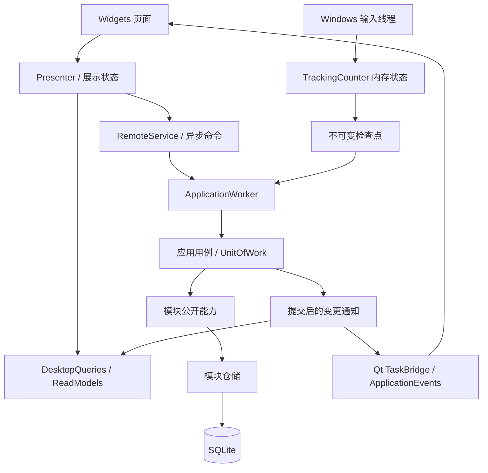

# Sariana 项目架构

Sariana 是 Windows 本机桌面应用，使用 Python、PySide6 Widgets、pyqtgraph 和 SQLite。当前采用模块化单体：一个进程、一个用户数据库、多个业务模块。没有 Redis、Web 后端、账户或云同步依赖。

## 启动和代码导航

先读 `main.py`，再读 `app/bootstrap/application.py` 和目标模块的 `api.py`。启动顺序为：单实例锁 → 应用工作线程创建数据库连接 → 迁移和恢复 → 装配模块服务 → 建立展示读模型 → 创建界面 → 启动输入钩子与定时保存。

| 位置 | 职责 | 修改时关注 |
| --- | --- | --- |
| `app/bootstrap/` | 装配、单一数据库工作线程、远程命令代理、展示读模型和功能入口 | 连接线程归属、启动失败、退出、异步命令 |
| `app/modules/*/api.py` | 对外服务、数据类型和能力契约 | 跨模块依赖、接口兼容 |
| `app/modules/*/repository.py` | 模块拥有的 SQLite SQL | 列归属、事务内写入 |
| `app/workflows/` | 跨模块用例、检查点、提交通知和导出 | 原子性、幂等、提交后的副作用 |
| `app/storage/` | 连接、版本迁移、工作单元、内部数据会话 | 旧库兼容、回滚、备份 |
| `app/integrations/ai/` | AI 协议、传输、请求结果和生成准入控制 | 配置快照、用量、超时、取消 |
| `app/ui/` | Widgets、Presenter、Qt 异步桥接、主题和图表 | 输入法、保存状态、结果失效、布局 |
| `app/core/` | Windows 输入/TSF 适配、基础工具及旧入口 | 隐私、组字、不重复计数 |
| `config/` | 奖励配置、成就定义、内置词库 | 业务口径与资源路径 |
| `scripts/` | 隔离测试、预览、架构检查和构建 | 测试夹具与真实应用路径的差异 |

`app/services/`、`app/english/`、`app/companion/` 和部分 `app/core/` 文件仍保留旧导入的转发入口，供历史工具与测试使用。新业务代码从模块 `api.py` 接入。旧公共 `app/storage/repository.py` 已移除；`DataSession` 是工作流内部适配器，不应传进生产页面。

## 业务与数据归属

| 模块 | 自己负责的规则和数据 |
| --- | --- |
| tracking | 输入计数、统计快照、日切；`daily_stats` 的统计列、`minute_stats`、`lifetime` 的统计列 |
| practice | 普通范文、逐字评分、成绩和纪录、键盘侠；`challenge_history`、`ai_texts`、`keyboard_warrior_history` |
| english | 词库、拼写会话、单词对齐评分、复习和英语材料；`english_attempts`、`english_progress`、`english_sentences` |
| growth | 等级、经验、打卡、成就、库存、奖励上限和资格；`growth_daily`、`rewards`、`checkin_log`、`achievements`、经验相关列 |
| companion | 活动/情绪状态、互动、作品包；数据目录中的 `companion/packs/` |
| profile | 昵称、签名、头像和配置保存；个人资料配置及头像文件 |
| reporting | 只读统计查询和有界查询缓存，不负责发奖或修改统计 |

物理表仍与旧版本兼容：tracking 不覆盖 `lifetime.total_exp` 或 `daily_stats.exp_gained`；growth 只更新经验列，不覆盖统计列。

`settings` 仍是共享键值表。`DataSession.set_settings()` 将经验结算、里程碑、加成和鼓励状态键路由到 growth 仓储，其余配置通过 profile 仓储保存。新的成长状态以 `growth_daily` 为主要持久化状态，旧经验设置键同时保留兼容。不要把出现在设置页的配置都变成一个万能业务服务。

## 调用与线程

- **Qt 主线程**管理窗口与控件。`TaskBridge` 将 Future 完成结果排队送回接收者的 Qt 线程；页面不得对未完成的 Future 调用 `result()` 等待。
- **ApplicationWorker**串行处理数据库命令。连接在该线程创建、使用和关闭，不能把连接转交给 UI 或网络线程，也不能通过关闭 SQLite 的线程检查掩盖违规访问。
- **输入线程**只更新带锁的内存计数器。上屏文本用于即时计数，不进入统计检查点或输入日志。
- **AI 网络线程**使用独立配置快照，不持有数据库连接，不修改 QWidget。
- 启动时允许在创建窗口和输入钩子之前等待迁移与恢复完成。退出时等待已接收任务和最终检查点完成。

`bootstrap/read_models.py` 保存从数据库脱离的展示数据；设置有字典索引，时段数据在后台预聚合。界面读取这些模型，不执行 SQL。报表缓存按数据版本和筛选条件区分；热力图在数据变更时复用已有格子，主题、年份或布局变化才重建。

生产界面使用 `DesktopApplication` 和 `DesktopQueries`。部分历史测试/预览使用同步 `DataSession` 夹具；它们可以快速测试业务规则，但不能证明生产线程和异步行为正确。涉及异步时应同时运行 `test_desktop_architecture.py`。

## 事务、幂等和通知

`UnitOfWork.transaction()` 拥有提交；嵌套操作使用 savepoint。模块仓储不自行 `commit()`，也不使用隐式提交的连接上下文。`DataSession` 在模块方法外协调事务和变更主题。

需要共同成功的写入放在同一个用例中，例如：

- 补签：检查日期和资格 → 消费 1 张卡 → 写补签 → 发放经验/里程碑 → 提交。
- 完成训练：保存成绩和纪录 → growth 结算经验/日上限 → 登记操作结果 → 提交。
- 保存 AI 材料：校验内容 → 事务内重新检查资格 → 消费训练券 → 保存材料 → 登记操作结果 → 提交。

`operations` 以 `(kind, operation_id)` 唯一保存成功结果。重试沿用同一个 ID，重复提交返回原结果；不是每次重试都创建新 ID。打卡、成就等还使用自身日期/状态约束。周期统计用检查点版本去重，不为每个输入事件建立操作记录。

变更通知在最外层提交成功后发出，并合并为提交批次。应用装配层更新受影响读模型，再通知 UI。订阅者异常会记录日志，不撤销已提交写入。Toast、彩带、小伙伴反应不能在保存成功之前触发。

## 快照、恢复和日切

`TrackingSnapshot` 用于实时展示，包含应用日、版本、采集时间、计数、不可变分钟序列和终身统计。`Checkpoint` 包含待保存日期、脏分钟行和终身累计状态，两者都不保存被动输入正文。

1. 输入事件增加内存版本，并标记变化的日期和分钟。
2. 主窗口启动的保存定时器每 2 秒请求一次检查点；无变化不写库，已有保存任务未完成时不堆积新的同类任务。
3. `CheckpointWriter` 在同一事务中写统计、growth 经验结算/高水位和 `tracking_checkpoint` 元数据。
4. 提交成功才 `acknowledge()`；只清除该版本以前的脏标记，捕获之后的新输入保留待保存。
5. 失败保持脏状态供重试。提交成功但确认丢失时，持久化版本阻止再次写旧状态或重复发奖。
6. 启动恢复最后完整提交，接着同一分钟累计，不重复增加活跃分钟或已结算经验。

`AppCalendar` 按本机墙上时间和配置的日切小时计算应用日，默认凌晨 4 点；练习时长使用单调时钟。输入跨日时在同一把锁内转换日期，旧日待保存数据不会被清空。修改日切设置也走同一路径。分钟表保持近 30 天，每日清理一次。

2 秒是正常存储条件下的尝试保存间隔，不是磁盘故障或系统阻塞下的硬性恢复保证。UI 显示保存失败和最后成功保存时间。SQLite WAL 配合 `synchronous=FULL`；应用检查点不是 SQLite WAL checkpoint，也不是历史备份系统。

退出顺序是停止接收新命令 → 取消结果接收 → 停止 TSF/键盘输入线程 → 等待在途保存 → 捕获最终检查点 → 提交 → 关闭数据库线程。关窗驻留托盘继续统计。

## AI 请求生命周期

同一个 `AIService` 的配置快照共享 `GenerationGate`。普通范文、英语和混乱生成共用准入控制；连接测试使用独立测试路径。

- 开始前检查配置、等级和训练券；请求捕获配置和开发者临时权限，不随设置草稿变化。
- 网络请求不占数据库事务，结果通过 `AIResult` 携带正文、用量与错误。
- `GenerationLease` 只有在网络结束且结果处理结束后才释放。取消使结果失效，不能提前放行仍在运行的网络请求。
- 材料保存失败时保留结果和请求 ID，再次点击执行保存重试，不能重新调用模型。
- 离开页面后丢弃迟到结果，不保存、不扣券。已受理的保存事务按自己的提交结果完成。
- 满级免费生成、英语不额外发放练习经验、开发者权限不持久化等原有行为保留。

英语提示词与校验由 english 拥有；普通范文/混乱目前仍有 AIService 的兼容便利入口。新增生成业务应将提示词和业务校验放在对应模块，复用通用请求/传输与准入机制，避免继续扩大传输服务的业务职责。`last_usage` 仅保留兼容，UI 请求流程使用完整结果，不建立新的旁路可变状态。

## 迁移、扩展与验证

`storage/db.py` 使用 `PRAGMA user_version` 管理版本，当前为 1。旧库升级前用 SQLite Backup API 在同一数据目录的 `migration-backups/` 创建备份，再执行原子增量迁移；失败回滚并停止启动。未来变更新增迁移版本，不能只修改初始 `schema.sql`，因为已升级的数据库不会重新运行旧迁移。原数据目录和单实例锁名继续兼容 TypingTracker。

新增功能依次确认：数据/规则所属模块 → 扩展该模块公开 API → 用例与事务 → 仓储 → 启动注入/读模型 → Presenter → Widgets → 边界测试。新增跨模块能力由 workflows 编排，不直接导入另一模块的内部仓储。

验证入口：

- `scripts/check_architecture.py`：UI 不导入数据库、纯规则不依赖 Qt/网络/SQL、模块之间走 `api.py`。它检查明确列出的纯规则文件，不是完整的传递依赖分析；新增纯领域文件应加入检查集合。
- `scripts/test_architecture.py`：事务失败、幂等、日切、恢复、迁移、工作线程和缓存。
- `scripts/test_desktop_architecture.py`：真实工作线程与 Qt 的异步保存、准入、取消和错误反馈。
- 原有 `scripts/test_*.py` 与 `scripts/selftest.py`：产品回归。
- `.github/workflows/regression.yml`：Windows 回归；`.github/workflows/windows-release.yml`：冻结包、安装/升级验证与发布流程。

完整操作命令与 AI 任务模板见 [agent.md](agent.md)。
