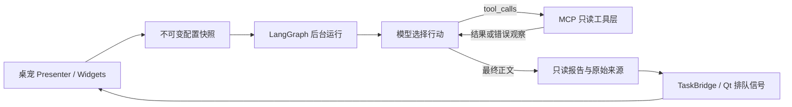

# 桌宠智能体与三期迭代

第一期已随 0.9.6 发布；第二期定时汇报与双视角记忆已随 [0.9.7](https://github.com/JeropsWang/typing-tracker/releases/tag/v0.9.7) 发布，第三期占卜已实现，0.9.8 正在发布验收。当前进度以 [项目接续状态](project-state.md) 为准，设计草案不代表功能已实现。后续提交、推送或发布仍需用户明确请求。

| 迭代 | 功能 | 验收重点 |
| --- | --- | --- |
| 一：联网搜索 | 配置云端/本地模型和搜索服务；圆形工具入口、话题输入、流式卡片、Edge 搜索与来源详情 | 真实搜索工具、取消和迟到结果、来源核对、思考过滤、异步配置保存 |
| 二：定时汇报 | 主动填写兴趣与汇报时间；应用后台驻留时搜索热点，以短卡片推送，点击打开完整报告 | 显式画像、不读取被动输入、安静时段、停用与重启排期、防止重复推送 |
| 三：占卜 | 1—50 字问题；是／不确定／否占比及娱乐说明，复用输入框与卡片 | 比例校验、数值与文本标签、娱乐性估计说明、资料不足的处理 |

轮盘开放搜索、来信与占卜。占卜契约见 [占卜说明](companion-oracle.md)。点击来信只打开最近已保存报告或定时配置，不隐式联网；右键和托盘也提供入口。

第一期界面使用错落的弧形轮盘：搜索入口较大，占卜和定时来信入口保留后续提示。图标为本项目绘制的透明线性图形；轮盘中心可穿透点击，保留桌宠摸头和拖动。输入框与滚动卡片共用非对称手信轮廓、偏移衬纸和指向桌宠的尾巴，详情提供独立正文与来源阅读区。窗口靠近屏幕上沿时将卡片移至侧边，随桌宠或主窗口移动定位。

智能体设置分为「模型搭档 / 搜索偏好 / 定时来信 / 记忆」，切换时统一使用当前章节调色板，保留草稿测试、取消和异步保存。公开视觉参考及观察范围见 [视觉研究](companion-agent-design.md)。只转译组件形状和交互规律，没有复制参考站的角色或脚本。

配置分区使用独立浮动按钮与无边框内容栈，显式设置窗口和导航底板颜色，避免 Windows 的深色文档页签背景漏出。宽窗口为主表单配错位便签，窄窗口换行；切换分区会统一背景、控件与主操作颜色。当前桌宠头像、切角衬纸、折页、大编号、斜线和点阵由本机素材与原生绘制构成，装饰不响应鼠标、不启动动画或网络请求。

联网搜索的真实进度对应「找线索 / 读来源 / 写手信」，循环中可能多次回到搜索或核对，不显示虚构百分比。桌宠在查询和判断时呈现专注姿态及短句，完成后短暂回应，取消后恢复原状态。这些反馈仅属于 UI，不发放奖励或制造业务事件；练习、摸头和已提交奖励反应仍优先。阶段亮点与悬停动画遵守减弱动态效果，隐藏窗口会停止视觉计时器；流式更新保留用户的阅读位置。

## 配置与使用

入口是「小伙伴右键 → 本地二创工坊 → 智能体 · 联网搜索设置」，也可从桌宠右键直接打开智能体设置。

- 默认关闭，无主动网络请求。模型配置独立于训练/英语，不复用 Key、准入门或训练券。
- 支持 OpenAI、DeepSeek、本地和其他 OpenAI 兼容接口。本地默认 `http://127.0.0.1:11434/v1`、`qwen3:1.7b`；Ollama/LM Studio 可填写自己的地址与模型，本地无需 Key。
- 默认「Edge 浏览器搜索 · 免 Key」在后台启动本机 Edge 无头进程，优先读取中文 Bing 搜索 DOM。模型自行选择关键词，收到结果后可改写补搜，或用来源编号调用正文读取工具。它是应用调用浏览器检索能力，并非在 Widgets 内嵌 Edge/WebView2 页面。每次工具搜索仍拆分中文时间/请求词、按主题词过滤，无相关证据时最多重试一次核心关键词查询（不变时换 Bing 入口）。错误交回模型判断；未取得真实资料不能生成成功报告。词面过滤支持省钱/节约开支、减肥/减重、找工作/求职等少量表达，不等于完整语义理解。页面空结果与全部跑题分别提示。无需 Docker 或搜索 Key；机器须已有 Edge。
- Edge 使用一次性独立配置目录，不接触个人浏览器配置、登录、历史记录；取消/超时只结束本次拥有的进程。搜索 DOM 最多 2 MB/30 秒，来源正文单页最多 2 MB/6 秒；不执行来源页面 JS，仅解析 HTML 正文，拒绝内网地址和非 HTTPS 来源；已配置 HTTPS 代理时兼容仅用于域名映射的 198.18.0.0/15 Fake-IP，不允许直连该地址段。读取失败保留原搜索摘录，不伪造正文。
- 「轻量网页搜索 · RSS」保留为明确可选方式。搜索页面验证码、限流、DOM 变化或 Edge 缺失会提示切换服务，不暗中把浏览器失败当作成功。
- 模型默认开启思考（支持对应协议的模型），思考标签内容过滤；DeepSeek 工具调用续接所需的协议字段仅在本次任务内存中回传，不显示、不持久化。普通模型使用自身正常模式，未知代理接口由服务端能力决定。模型和兼容服务需要支持原生 `tools/tool_calls`，不支持时会报告失败或没有搜索证据，不退回固定管线冒充自主搜索。设置提供关闭思考选项；连接测试仍用非思考短请求，通过不代表已验证工具或思考能力。
- Tavily 搜索 API（独立搜索 Key）与已有 SearXNG（开启 JSON 格式）为可选方式。应用仅连接已有服务，不安装、启动或停止容器。旧托管模式读取时切换为免 Key 网页搜索；明确选择的外部服务配置保留。
- 高级用户需要自己部署 SearXNG 时，可参考 [可选部署配置](../deploy/searxng/README.md)，它不属于应用安装与使用的必要步骤。
- 「测试模型连接」用当前未保存草稿发送最多 32 输出 token 的短消息；显示实际模型、耗时或失败原因，不需要先开启智能体，也不发起搜索。「测试搜索」检查当前搜索服务是否能返回可引用结果。连接测试均后台运行，可取消；保存失败与测试失败各自保留草稿。
- 默认话题仅预填，不自动执行。用户主动输入话题，上限 200 字；第一期没有定时请求或用户画像。
- 配置取消不保存；经 ApplicationWorker/UnitOfWork 原子提交，失败保留草稿。Key 输入框密码显示，随现有配置保存到本机 SQLite，**并未加密**；日志和错误提示不输出 Key。
- 搜索发送主动话题与摘录；来信另发送已保存的显式兴趣与日期。不读取被动键盘输入正文、昵称、统计或练习成绩。主动搜索报告仅在内存；来信报告成功提交后保存在本机，可重启阅读。

远程服务要求 HTTPS，本机/局域网支持 HTTP；URL 不允许嵌入凭据，带凭据请求拒绝重定向。每次搜索最多 5 条来源，本次任务去重后最多 8 条，编号保持稳定；搜索摘录最多 2000 字，正文节选最多 2500 字，响应最多 2 MB。资料视为不可信数据，提示要求忽略其中的指令。详情仅将搜索服务返回的 HTTP/HTTPS 来源作为链接，模型正文不执行 HTML 或链接。

## Pi 参考与 LangGraph 运行

下载并阅读 [Pi 官方源码](https://github.com/earendil-works/pi) 的模型适配、提示词装配、行动循环和 MCP 工具接口，用 Python 独立实现相应分层，没有引入 TypeScript 运行时或复制其代码。本机源码位置、固定提交和阅读顺序见 [Pi 源码导读](pi-agent-study.md)。保留 [LangGraph StateGraph](https://docs.langchain.com/oss/python/langgraph/graph-api) 的真实节点、状态、编译和执行能力。



执行路径为 `START → model → tools → model … → END`，模型自主选择搜索、读取、补搜和结束。工具错误反馈到下一轮；参数校验和只读白名单在代码执行，不只依赖提示词。没有真实搜索来源时最多提醒模型一次，仍无证据则明确失败；不存在的引用编号也最多修正一次。

每次任务最多 6 次模型请求、8 次尝试工具调用（错误参数也计数）、3 次搜索、3 次正文读取、8 条去重来源。精确重复行动缓存结果，避免重复网络请求。一次 Edge/RSS 工具搜索内部最多尝试两个入口/关键词，所以整次任务最多 6 次搜索上游尝试。上下文最多 96,000 字符，任务合作式期限 300 秒，在请求/读取/节点检查点执行，不能即时打断尚未返回的阻塞 I/O。达到限额保留已有真实资料并显示警告。

`mcp_tools.py` 支持 MCP `2025-11-25` 的进程内 JSON-RPC 初始化、tools/list、tools/call 子集；inputSchema 转为模型函数声明，调用结果使用 content/structuredContent/isError。当前没有 stdio/HTTP 外部服务器、OAuth、resources 或完整 MCP SDK。两项工具是 `web_search(query)`、`read_webpage(source_id)`；模型不能构造任意读取 URL。后续外部 MCP 接入需独立实现连接、取消、凭据和授权边界。

| 代码 | 职责 |
| --- | --- |
| `app/modules/companion/agent.py`、`persona.py`，由 `api.py` 公开 | 配置、轮次/调用/限额、来源与报告契约；默认角色和资料规则 |
| `mcp_tools.py` | MCP 工具子集、schema 校验、来源台账、错误观察与工具限额 |
| `app/integrations/companion_agent/search.py` | 公开 RSS/Tavily/SearXNG 传输、来源校验、限额和错误映射 |
| `edge_search.py`、`pages.py` | 隔离 Edge 进程、DOM 来源提取及有界原文节选 |
| `model.py`、`stream.py` | 兼容模型、原生工具调用、私有协议续接、SSE 分片和可见正文过滤 |
| `graph.py`、`service.py` | LangGraph、独立后台线程、准入与取消 |
| `setup.py` | 草稿模型与搜索连接测试 |
| `app/bootstrap/features.py` | 能力装配，不传数据库连接 |
| `app/ui/companion/agent_controller.py` | 请求 ID、展示状态、排队回调、定位与销毁 |
| `agent_widgets.py`、`agent_settings.py` | 可复用输入框、滚动卡片、详情和分区配置草稿 |
| `agent_visuals.py`、`agent_controls.py` | 配色、非对称纸张、轮盘按钮、阶段指示与视觉计时器 |

网络线程没有数据库和 QWidget。取消立即使结果与进度失效，连接在后续读取或超时结束；任务真正结束前不准入另一任务。隐藏桌宠收起窗口并保留输入草稿，迟到结果不会弹出。退出取消网络、停止接收回调，沿用原统计退出流程。

取得真实来源后，可见正文草稿约每 80 ms 排队一次；收到工具调用时切回寻找/核对状态，整轮结束及校验后才成为报告。用户向上滚动时不强制跳到底部。`reasoning_content` 不进入 Qt 进度和报告，但按 DeepSeek 协议要求随前序 assistant 消息在本轮内存中续接；跨片段的 `<think>`/`<analysis>` 内容仍过滤。思考开关复用现有协议，本地开启时发送 `reasoning_effort=high` 与 `think=true`，单次正文/思考共享 8192 输出 token 预算；关闭时单次行动/正文预算 1600 token。兼容 `summarize` 短路径仍保留给独立调用，生产搜索不使用它。

单次流式读取期限 180 秒；截断、未完成或缺失调用标识的工具响应不执行。图执行上下文显式关闭 LangSmith tracing，避免环境变量开启话题上传。模型调用失败时保留真实搜索来源和警告，不伪造结果；没有证据就不会把模型记忆包装成报告。

## 验证和打包

自动测试使用隔离数据与模拟响应，不调用付费接口。

```powershell
$env:QT_QPA_PLATFORM = 'offscreen'
.venv\Scripts\python.exe -B -m unittest discover -s scripts -p 'test_companion_agent*.py' -v
.venv\Scripts\python.exe -B -m unittest discover -s scripts -p 'test_companion_react.py' -v
.venv\Scripts\python.exe -B -m unittest discover -s scripts -p 'test_companion_ui.py' -v
.venv\Scripts\python.exe -B -m unittest discover -s scripts -p 'test_desktop_architecture.py' -v
.venv\Scripts\python.exe -B scripts/preview_companion_agent.py
.venv\Scripts\python.exe -B main.py --companion-agent-selfcheck
```

用户授权后可启动 Ollama 并运行本机验证。未填写 `--search-url` 或 `--public-search` 时搜索是本机 HTTP 夹具，模型和 LangGraph 为真实执行，不能将结果描述成已验证真实搜索服务。

```powershell
.venv\Scripts\python.exe -B scripts/verify_companion_agent_local.py --model qwen3:1.7b
# 真实免 Key 搜索与本地模型：
.venv\Scripts\python.exe -B scripts/verify_companion_agent_local.py --public-search --topic "Python 编程语言官方网站"
# 已有启用 JSON 的 SearXNG 时，补充真实搜索：
.venv\Scripts\python.exe -B scripts/verify_companion_agent_local.py --search-url http://127.0.0.1:8080
```

新增 LangGraph 依赖，发布锁定 `1.2.15`；不需要 LangGraph 云服务。冻结构建收集子模块和依赖元数据；校验新增模块，并运行真实冻结程序 `--companion-agent-selfcheck`。该自检不联网、不建库。实际结果及未验证项见 [validation.md](validation.md)。

轻量 RSS 搜索复用有界传输，每次工具搜索最多两个公开域名尝试，每次超时 25 秒；不发送模型或搜索 Key。各适配器取得的来源都可由模型按编号选择读取公开 HTTPS 正文节选。RSS 拒绝 DTD/实体声明，非 RSS、验证码和空结果不视为成功。安装包无需携带 SearXNG 模板或外部搜索运行时。配置窗口默认 Enter 保存，不会意外触发付费连接测试。

## 后两期边界

第二期画像由主动填写的兴趣和经用户允许的话题历史构成，不分析被动输入。关主窗口驻留托盘继续调度，退出进程即停止。失败不记为成功推送；启动和唤醒需限频，避免积压或重复。设置开关、汇报时间、安静时段、下次时间和手动汇报均在同一配置页。报告与调度持久化通过 companion 公共 API、工作线程和 UnitOfWork。

第三期问题为 1—50 字；只接受严格三字段整数 JSON 且总和 100，图表之外保留数值和文字标签，不生成解释正文。概率是娱乐性的模型估计，不是客观校准的真伪置信度；资料不足需明确说明。复用第一期的输入框、卡片和详情，图表作为独立组件，避免重复窗口和网络逻辑。

## 0.9.7 当前入口

桌宠右键 → 桌宠智能体设置 → 定时来信：填写最多五个兴趣、每日时间与安静时段，保存才生效。默认关闭；「现在联网准备一封」明确使用已保存配置，可能产生模型／搜索费用。自然日两小时窗口之外不补做，安静顺延跨日则跳过；退出应用不运行。

来信与搜索共用默认角色、有界 LangGraph ReAct 和进程内 MCP 工具。`run_news` 通过结构化 user 数据传兴趣与日期，不把用户文字插入 system。无来源拒绝成功，有真实来源的部分整理可带警告保存；抓取时间不冒充发布日期。连接测试成功仍不代表真实新闻时效或模型工具能力通过。

记忆 → 我的记忆：看本人兴趣、已保存历史、正文和来源，可明确修改兴趣或删除报告。开发者标签展示相同 task_id 的状态／attempt／来源／报告结构，以及固定代码入口和可选 AOCI 原文。内存待存结果不混入保存历史。清空兴趣关闭排期；删除正文保留今日自动名额。通知不抢练习或阅读焦点，重启不重复展示已受理通知。

配置、调度、存储、索引和页面按职责分离；进一步拆分原有模型／搜索设置页可单独讨论。本轮没有引入新界面技术、Redis、ORM 或云记忆服务。占卜已实现，发布验收进度以当前项目状态为准。

## 来信故障与本机验收

排期、当前进度和最近失败分别显示。失败码区分模型／搜索及连接、鉴权、限流、超时、协议和无来源；旧 network 显示「历史失败原因未细分」，不能反推出具体上游原因。关闭智能体或桌宠时显示排期暂停；过去日期的自动失败不能重试，改用「现在联网准备一封」。删除仍保留当日名额。

失败状态提交后，桌宠在可见、非安静、未练习且未阅读时提醒一次；重启只恢复最近失败说明，不反复弹历史气泡。取消不报故障。正文保存失败与失败状态保存失败分开提示，两者的保存重试均不重新调用模型。本机模型单次传输预算120秒，远端／搜索25秒；取消仍要等阻塞 I/O 真正结束。

显式本机验收脚本使用已有模型，不下载，数据和脱敏结果仅写 `.local`。受控模式的模型／图／工作线程／Qt 为真实执行，搜索和正文为夹具；真实联网模式还需 `--public-search`。`--timer` 等下一分钟，并由正式30秒计时器领取自动任务；报告先提交再显示卡片。Edge 的 Windows 临时目录占用只能尽力清理，不能覆盖已取得的 DOM 或原始失败；RSS 是独立可选搜索模式，不等于 Edge 已验证。

```powershell
.venv\Scripts\python.exe -B scripts/verify_companion_news_local.py --model qwen3:1.7b --output .local/news-reliability/manual-fixture
.venv\Scripts\python.exe -B scripts/verify_companion_news_local.py --model qwen3:1.7b --public-search --search-provider web-lite --timer --output .local/news-reliability/manual-live
```
