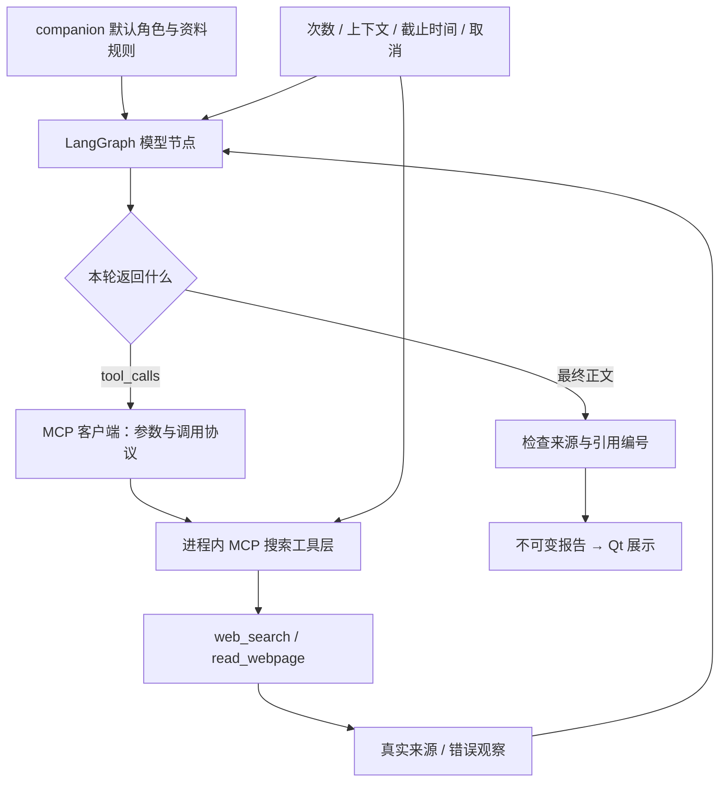

# Pi 源码导读与 Sariana 对照

本机参考源码已下载到 `.local/references/pi/`，来自 [Pi 官方仓库](https://github.com/earendil-works/pi)，固定提交 `6374c2baf432419ccb4541a99ce4958ecd03dae0`（2026-10-14 下载时的 HEAD）。这是浅克隆，保留 Git 元数据和 MIT 许可证；未安装 npm 依赖、运行脚本或修改源码。`.local/` 被当前项目忽略，参考仓库不进入安装包。

直接用编辑器打开该目录即可研究；不需要先运行 Pi。下面的在线链接固定在同一提交，避免上游更新后对照发生变化。

## 推荐阅读顺序

| 顺序 | 本机 Pi 文件（相对参考目录） | 看什么 | Sariana 对照 |
| --- | --- | --- | --- |
| 1 | `packages/agent/README.md` | 最小 Agent、消息流、事件流、取消、工具钩子 | `service.py` 与 UI 请求生命周期 |
| 2 | `packages/agent/src/types.ts` | AgentContext、AgentTool、工具结果、运行钩子和事件契约 | companion API 中的配置、AgentTurn、AgentToolCall、报告 |
| 3 | `packages/agent/src/agent-loop.ts` | `runLoop`（163 行）、`prepareToolCall`（708 行）、`runToolCall`；模型与工具结果循环 | LangGraph `graph.py` |
| 4 | `packages/coding-agent/src/core/system-prompt.ts` | `buildSystemPromptSections`（128 行）；角色、工具规则、上下文分段装配 | companion `persona.py` |
| 5 | `packages/ai/src/types.ts` | ToolCall（436 行）、AssistantMessage（565 行）；模型供应商共享协议 | `model.py` 与 `stream.py` |
| 6 | `packages/mcp/README.md`、`packages/mcp/src/client.ts` | 初始化、请求 ID、tools/list、tools/call、取消、传输责任 | `mcp_tools.py` 的进程内工具子集 |
| 7 | `packages/agent/examples/mcp-codemode/main.ts`、`tools.ts` | MCP 工具如何包装为 AgentTool，再进入同一循环 | MCP schema → 模型 function 声明 → MCP 执行 |

对应固定版本的在线源码：[行动循环](https://github.com/earendil-works/pi/blob/6374c2baf432419ccb4541a99ce4958ecd03dae0/packages/agent/src/agent-loop.ts)、[类型契约](https://github.com/earendil-works/pi/blob/6374c2baf432419ccb4541a99ce4958ecd03dae0/packages/agent/src/types.ts)、[提示词装配](https://github.com/earendil-works/pi/blob/6374c2baf432419ccb4541a99ce4958ecd03dae0/packages/coding-agent/src/core/system-prompt.ts)、[MCP](https://github.com/earendil-works/pi/blob/6374c2baf432419ccb4541a99ce4958ecd03dae0/packages/mcp/README.md)。

## 源码说明了什么

Pi 的 Agent core 负责消息、模型轮次、工具执行和事件，不把一个固定角色写死在循环里。coding-agent 的提示词装配负责角色和工具规则；桌宠应有自己的默认角色，不能照搬编码助手的文件、命令行指令。

`runLoop` 每轮生成 assistant 消息，提取 toolCall，校验/执行工具，把 toolResult 放回上下文，然后继续调用模型。没有工具调用且没有后续消息时结束。工具失败以错误结果反馈，模型有机会调整行动；截断输出里的工具调用不会直接执行。系统支持输入 steering、后续消息、请求准备和完成钩子。

当前下载版本含 `packages/mcp`，不能按早期 Pi 的资料推断“Pi 没有 MCP”。MCP 负责工具发现和调用协议，ReAct 负责依据观察选择下一步，两者职责不同。MCP 工具经过适配后，与普通工具进入同一执行循环和钩子。

这些是对所下载源码的概括。Sariana 使用 Python 独立实现相应分层，保留 LangGraph 和原有 Widgets；没有复制 Pi 的 TypeScript 实现，也没有引入 Node 运行时。

## Sariana 的实际落点



- 默认角色与资料规则由 [persona.py](../app/modules/companion/persona.py) 所有，经 companion API 公开。当前时间和预算在每次任务开始时装配。
- [graph.py](../app/integrations/companion_agent/graph.py) 执行真正的 `model → tools → model` 条件循环。模型选择关键词、来源和补搜，错误观察回到下一轮；来源不足和不支持工具调用不能伪装成搜索成功。
- [mcp_tools.py](../app/integrations/companion_agent/mcp_tools.py) 使用进程内 JSON-RPC 边界，支持 MCP `2025-11-25` 的初始化、tools/list、tools/call 子集。两项工具的 JSON Schema 是工具声明来源；模型协议只是转换该声明，不直接执行 Python callable。
- [model.py](../app/integrations/companion_agent/model.py) 转换原生 function tool_calls；[stream.py](../app/integrations/companion_agent/stream.py) 拼接有界 SSE/JSON 响应，拒绝截断调用。DeepSeek 所需 `reasoning_content` 仅在任务内存中回传，报告、进度和持久化不包含它。[DeepSeek 协议说明](https://api-docs.deepseek.com/guides/thinking_mode/)
- 限额、取消和工具白名单由代码执行，不只写在提示词里。当前最多 6 次模型请求、8 次尝试工具调用、3 次搜索、3 次正文读取、8 条稳定编号来源；正文读取只能选择已搜索编号，再通过原有公开 HTTPS 检查。

MCP 实现范围按 [官方工具协议](https://modelcontextprotocol.io/specification/2025-11-25/server/tools) 和 [生命周期](https://modelcontextprotocol.io/specification/2025-11-25/basic/lifecycle) 定义。它是受限的本机工具子集，没有 stdio/HTTP 外部服务器连接、OAuth、resources、分页或通用 JSON Schema 引擎；Pi 的完整 MCP 客户端才是后续外接服务器时应继续研究的部分。

Pi 的持久会话、上下文压缩、扩展注册、steering 和权限钩子仍属于后续研究。本期不增加 shell/文件工具、画像、定时推送或任务历史数据库。原有业务工作线程、独立配置、取消准入与迟到结果边界保留。

## 研究与验证方式

先在 `agent-loop.ts` 给 assistant 生成、工具执行和 toolResult 回填三处做阅读标记，再看 MCP 示例如何把远程结果包装成 AgentToolResult。最后对照 Sariana 的条件边与来源台账，区分“模型选择的策略”与“运行层强制的边界”。

Sariana 的自动验证不需要真实 Key：

```powershell
.venv\Scripts\python.exe -B -m unittest discover -s scripts -p 'test_companion_react.py' -v
.venv\Scripts\python.exe -B main.py --companion-agent-selfcheck
```

真实搜索质量还受搜索上游、模型原生工具调用能力和模型判断影响。模拟测试能验证循环与边界，不能证明任意话题结果正确；本轮未调用云端付费模型或重验真实本地模型。
